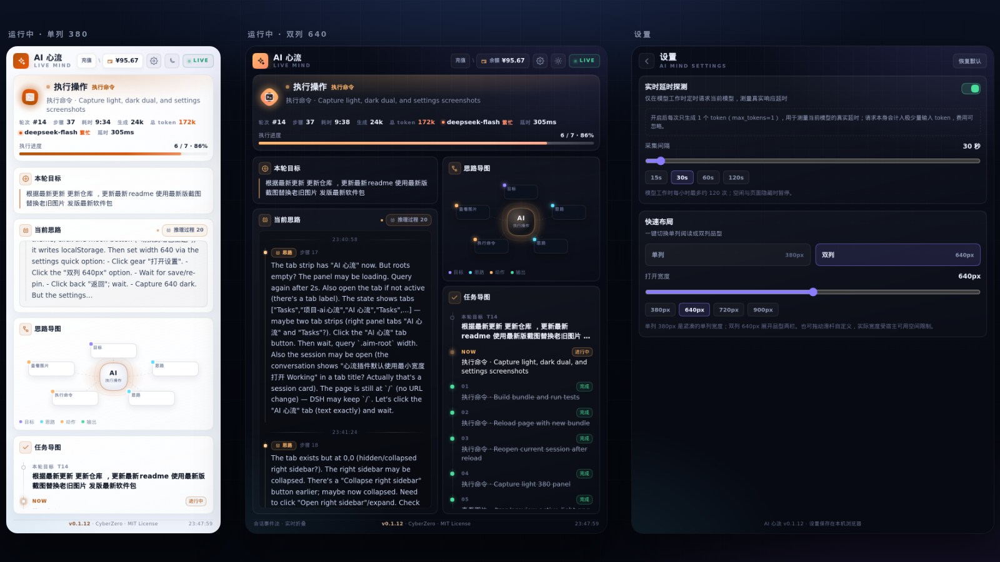

# dsh-ai-mind · AI 心流

作者：**CyberZero** · GPL-3.0 License · 当前版本：`v0.1.14`

DSH 右侧栏插件：把当前会话里 AI 的**实时状态、思路、任务进度、思路导图、任务导图**折叠到一页。

## 预览

<p align="center">
  
</p>

左：单列 380（亮色）；中：双列 640（暗色）；右：设置页。单列/双列可在设置里一键切换，打开宽度按设置固定。思路与代码创作共用一条时间线，时间戳分割线区分段落，代码块显示文件名、增删行数与预览。标题栏提供「充值」按钮并只读显示 DeepSeek 余额，指标区包含当前模型延时与当前窗口总 token，任务导图会把正在执行的工具置顶为 `NOW`。

## 显示什么

- **实时阶段**：待命 / 等待响应 / 推理中 / 组织回答 / 执行操作 / 本轮完成 / 需要处理。
- **当前动作**：正在调用的工具、目标文件或命令、轮次、步骤、耗时、生成 token，以及当前窗口输入/缓存/输出的总 token（悬停可看拆分）。
- **本轮目标**：最后一条真实用户消息。
- **当前思路**：模型可见的 reasoning 流与 `write` / `edit` / `code` 代码创作共用一条时间线；每段以时间戳分割线切开，「思路」/「代码创作」标记区分类型，代码块显示文件名、增删行数与可滚动预览，流式输出时实时追加。标题栏的「推理过程 N」可回放本轮最近 20 段纯推理；向上翻阅时不会被新输出强制拉回底部。
- **思路导图**：目标 → 思路 → 最近动作 → 输出，以放射状节点图呈现，当前动作高亮。
- **任务导图**：优先读取 `todo/write` 的任务清单与完成度；清单超过 40 步未刷新时自动退回真实工具轨迹，并把进度标为「执行进度」，避免展示过期计划。当前正在执行的工具会以 `NOW · 进行中` 置顶显示，不依赖它是否出现在待办清单里。
- **实时进度条**：完成数 / 总数，执行中带流光动画。
- **充值入口与余额**：标题栏「充值」按钮直达 DeepSeek 充值中心，旁边只读显示账户余额；余额不足时余额变警示色。
- **当前模型延时**：模型 chip 后显示当前会话模型的真实响应延时；任务工作时按设置的间隔（默认 30 秒）发一次 `max_tokens=1` 的极短请求采样，任务结束转入空闲后立即停止，避免空转消耗配额，可在设置里关闭或调整间隔。
- **单列 / 双列**：设置页可一键切换单列 380 与品型双列 640；面板按设置宽度打开，窄栏单列阅读、宽栏展开 bento 双列。
- **面板设置**：标题栏齿轮按钮打开设置页，可开关延时探测、调整采集间隔（10–600 秒）、把打开宽度设为 320–960px，或一键切换单列/双列；设置保存在本机浏览器。
- **亮色 / 暗色主题**：默认跟随 DSH 当前外观，也可在标题栏一键切换。

数据来自 `ctx.sessions` 的会话事件窗（durable event + `assistant/live-chunk`），不调用模型、不在服务端落任何数据。例外是余额查询与延时探测：插件服务端用本机 `DEEPSEEK_API_KEY` 查询官方余额接口（缓存 60 秒），延时探测每次只请求 1 个输出 token、服务端缓存 20 秒，并且只在模型工作时发出；页面每分钟刷新余额，切回页面时立即刷新。仅把币种、金额与延时毫秒数返回浏览器，密钥不下发。

## 更新日志

### 0.1.14

- **许可证变更为 GPL-3.0**：分发许可证从 MIT 改为 GNU General Public License v3（`GPL-3.0-only`）；`LICENSE` 换成 GPL v3 全文并附版权声明，`package.json` 的 `license` 字段同步。
- **面板署名同步**：底部小字与悬停提示从 `CyberZero · MIT License` 改为 `CyberZero · GPL-3.0`。
- **文档同步**：README 的版权与许可、版本对应关系、下载与安装说明更新到 0.1.14。
- **不追溯**：已发布的 0.1.14 及更早版本仍按当时的 MIT 授权分发。

### 0.1.13

- **修复 DSH 0.2.1 上余额与延时 404**：0.2.1 移除了 `webRuntime` 服务，宿主侧仍等着它才注册路由，导致 `/dsh-ai-mind/balance` 与 `/dsh-ai-mind/latency` 静默不挂载。改为等待已注入的 `webServer` 后，余额与模型延时恢复显示。
- **完整包依赖对齐**：发布 zip 的 `vendor/` 换成 `dsh-better-sidebar-0.28.2`（peer 指向 DSH 0.2.1 一代），安装脚本同步；已装更高版本时仍跳过，不会降级。
- **无界面变更**：`lib/client.js` 与 0.1.12 一致，仅宿主侧路由修复。

### 0.1.12

- **面板设置页**：标题栏齿轮打开设置，可开关延时探测、把采集间隔调到 10–600 秒、把打开宽度调到 320–960px，并提供单列 380 / 双列 640 一键切换；设置写入本机 `localStorage`，无需改配置。
- **当前模型延时**：模型 chip 后显示当前会话模型的真实响应延时；只在任务工作时按设置的间隔发一次 `max_tokens=1` 的探测，空闲、页面隐藏或打开设置时暂停，避免空转消耗配额。
- **单列 / 双列**：484px 及以下为单列，更宽展开品型双列；默认 380px 紧凑单列，可一键切到 640px 双列。旧设置里的 480 / 400px 自动迁移到 380。
- **固定打开宽度**：每次打开右侧栏按设置宽度展开，不继承宿主 45% 默认；手动拖拽只在本次打开期间生效。
- **模型识别**：优先读会话投影 `modelSelection`，空闲会话也能显示当前模型，延时探测不再因缺少 `request/context` 而失效。
- **暗色与图标**：移除会触发宿主 glass 规则清空背景的 `data-phase`，暗色面板真正变暗；设置按钮改为齿轮图标。
- **安全加固**：余额与延时路由复用宿主 `connection.requestRejection`（未登录 401，跨站/异源 403）；上游禁用 302 跟随，`DEEPSEEK_BASE_URL` 仅接受 https，响应体限制 64KB，探测并发 8、每分钟 60 次。
- **完整包**：发布 zip 内的 `install.sh` 改为本地安装脚本，直接安装包内 `vendor/dsh-better-sidebar-0.26.0.tgz` 与插件 tgz，不再二次下载。
- **测试**：`npm test` 覆盖宽度、轮询、设置、鉴权与上游边界，共 36 项通过。

### 0.1.11

- **思路与代码创作**：当前思路卡片改为共用时间线，`write` / `edit` / `code` 调用以「代码创作」条目插入，显示文件名、增删行数、语言与代码预览；每段用时间戳分割线切开，并保留「思路」标记。
- **实时追加**：流式推理和运行中的代码操作会立即出现在时间线末尾，完成后自动转为静态条目；向上翻阅时不被强制拉回底部。
- **响应式布局**：双列断点从 640px 下调到 480px；480–640px 使用紧凑双列，小于 480px 切单列，单列高度不足时面板可滚动。
- **页脚版本**：面板底部显示当前插件版本，随构建自动注入。

### 0.1.10

- **一键安装**：新增根目录 `install.sh`，一条命令完成下载、SHA256 校验、解压和安装；从 GitHub Releases 取包，`AIM_VERSION` 可指定版本。
- **安装脚本**：完整发布包内的 `install.sh` 会检测 `dsh-better-sidebar`，已安装时跳过，避免把较新版本降级到 0.26.0。
- **README**：重写下载与安装章节，以当前版本的一键安装为默认方式，保留手动安装、纯插件包和源码安装。
- **发布同步**：v0.1.6–v0.1.10 的 Release 与安装包已补齐，下载链接保持一致。
- **无插件行为变更**：`lib/client.js` 与 0.1.9 一致，已装 0.1.9 的用户可按需升级。

### 0.1.9

- **文档**：新增「左侧会话列表标题换行、时间掉到第二行」的排查说明，给出 DSH 模块加载器认领未打标 `<style>` 的定位方法与修复方式。
- **文档**：下载链接、安装命令、打包说明更新到 0.1.9。

### 0.1.8

- **充值按钮配色**：与余额胶囊统一为同底色、同描边、同字号，悬停反馈保持一致；亮色主题同步，「充值 \ 余额」视觉上成为一组。

### 0.1.7

- **充值按钮**：标题栏余额区拆成「充值 \ 余额」；`充值` 改为强调色按钮，点击直达 DeepSeek 充值中心。
- **余额只读**：`余额 ¥x` 只展示金额，不再整块可点；悬停仍显示查询时间与充值入口提示。

### 0.1.6

- **作者与授权**：右侧栏面板底部中间常驻小字 `CyberZero · MIT License`；窄面板或矮窗口只隐藏两侧辅助信息，署名保持可见。
- **版权声明**：README 新增「版权与许可」章节，作者、`LICENSE` 与 `package.json` 统一为 CyberZero，并注明再分发时保留声明。

### 0.1.5

- **DeepSeek 余额**：标题栏常驻显示充值中心余额，点击直达充值页；服务端用 `DEEPSEEK_API_KEY` 查询并缓存 60 秒，密钥不下发浏览器。
- **余额自动刷新**：页面每分钟更新一次，切回页面立即刷新；请求失败自动重试。
- **推理过程回放**：当前思路卡片可展开本轮最近 20 段推理，流式输出时实时追加；向上翻阅时不会被强制拉回底部。
- **任务导图 NOW**：正在执行的工具置顶为 `NOW · 进行中`，即使它还没写进 todo 清单也会显示。
- **总 token**：执行进度卡片新增当前窗口输入 / 缓存 / 输出合计，悬停查看拆分。
- **网关兼容**：余额请求改用相对路径，兼容 fnOS `/app/...` 反向代理前缀。
- **文档与预览**：重写安装说明，更新运行中 / 完成态、亮色 / 深色三张预览图。

### 0.1.4

- 一屏式 bento 面板：实时阶段、当前动作、本轮目标、当前思路、思路导图、任务导图。
- 亮色主题、按面板宽度切换的单列布局、会话跟随与自动收起。

## 布局

右侧栏是一块固定的一屏 dashboard，页面本身不滚动：

- 顶部状态 hero：阶段、当前动作、五项指标、执行进度；
- 2×2 bento：左侧「本轮目标 + 当前思路」，右侧「思路导图 + 任务导图」；
- 卡片内部各自滚动，长思路、多任务不会把整页撑开；
- 用容器查询按**面板宽度**（不是浏览器视口）切换：484px 及以下为单列布局，更宽时展开品型双列；单列高度不足时面板可滚动，避免卡片被压扁。
- 右侧栏每次打开按设置里的「打开宽度」展开，默认 **380px**（紧凑单列宽度），不继承宿主默认的 45% 宽度；手动拖拽只在本次打开期间生效，下次打开回到设置宽度。设置页可一键切换单列 380 / 双列 640；旧设置里的 480 / 400px 会迁移到 380。

## 设置

标题栏右侧的齿轮按钮打开设置页，改动即时生效并写入 `localStorage`（`dsh-ai-mind:settings`）：

- **实时延时探测**：开关控制是否请求模型；开启时每次固定 `max_tokens=1`，只生成 1 个 token，请求本身计入极少量输入 token，费用可忽略；
- **采集间隔**：10–600 秒可调，预设 15 / 30 / 60 / 120 秒；模型空闲时暂停，页面隐藏时也暂停，恢复工作或切回页面立即补一次采样；
- **快速布局**：一键切换「单列 380px」与「双列 640px」，切换后立即按新宽度重排；
- **打开宽度**：320–960px 可调，预设 380 / 640 / 720 / 900px。380px 为单列预设，484px 以上展开品型双列；实际宽度仍受宿主可用空间限制；
- **恢复默认**：回到开启探测、30 秒、380px。

## 主题

- 默认跟随 DSH 外观：DSH 是浅色时面板自动用亮色主题，DSH 切到深色时自动变暗；
- 标题栏右侧的太阳 / 月亮按钮可手动切换，选择写入 `localStorage`（`dsh-ai-mind:theme`），之后以手动选择为准；
- 亮色主题使用与深色版相同的布局和强调色体系，重新调过对比度，不会出现“白底灰字”。

## 跟随当前会话

- 打开有内容的会话时，标签自动出现在右侧，并随会话切换重新订阅 `scope.sessionId`，内容跟着对话走；
- 空白会话（首页 / New task）不自动打开，避免为了一个没有内容的 panel 挤占整个 DSH 布局；
- 如果从会话切回 New task，残留在空白会话里的「AI 心流」会自动收起，左侧栏目和顶部恢复原宽度；
- 手动关闭后，该会话不会再次自动打开；切到别的会话仍会正常出现。

## 下载

当前版本：`v0.1.14`

| 文件 | 用途 | 大小 | 下载 |
| --- | --- | --- | --- |
| 完整发布包 | 插件 + `dsh-better-sidebar` + 安装脚本 + README/预览图 | 约 5.6 MB | [下载](https://github.com/magicindex/dsh-ai-mind/releases/download/v0.1.14/dsh-ai-mind-0.1.14-fnos-release.zip) |
| 纯插件包 | 已装好 `dsh-better-sidebar` 时使用 | 约 59 KB | [下载](https://github.com/magicindex/dsh-ai-mind/releases/download/v0.1.14/dsh-ai-mind-0.1.14.tgz) |

发布页：https://github.com/magicindex/dsh-ai-mind/releases/tag/v0.1.14

校验值随发布提供，见发布页的 `SHA256SUMS` 附件。

> 下载与安装均由 GitHub Releases / GitHub Raw 提供。GitHub 访问受限时，请先配置代理或镜像加速再执行同样的命令；安装包可用 `SHA256SUMS` 自行校验。

## 安装

### 前置条件

- DSH `0.2.1-rc.5`（0.2.0-rc.2 起同样可用）。
- 已安装并启用 `dsh-better-sidebar >= 0.26.0`。插件通过它的公开 `registerTab` API 注册右侧页签；一键安装会自动补齐，已安装则跳过，不会降级。
- 使用**运行 DSH 的同一系统用户**执行安装命令，避免插件文件归属错误。
- 首次安装 `dsh-better-sidebar` 的传递依赖需要联网。
- 余额显示需要 DSH 进程环境里存在 `DEEPSEEK_API_KEY`；未配置时余额显示 `—`，其他功能不受影响。

### 方式一：一键安装（推荐）

在运行 DSH 的机器上执行，默认安装到 `web` profile：

```bash
curl -fsSL https://raw.githubusercontent.com/magicindex/dsh-ai-mind/main/install.sh | bash -s -- web
```

脚本会依次完成：

1. 下载 `v0.1.14` 完整发布包；
2. 下载 `SHA256SUMS` 并校验安装包；
3. 解压到临时目录；
4. 安装 `dsh-better-sidebar`（已安装则跳过）；
5. 安装 `dsh-ai-mind`，随后清理临时文件。

profile 不叫 `web` 时，把最后的 `web` 换成实际名称：

```bash
curl -fsSL https://raw.githubusercontent.com/magicindex/dsh-ai-mind/main/install.sh | bash -s -- <profile>
```

需要指定版本时：

```bash
# 指定版本（默认为 0.1.14）
curl -fsSL https://raw.githubusercontent.com/magicindex/dsh-ai-mind/main/install.sh | AIM_VERSION=0.1.14 bash -s -- web
```

安装完成后重启 DSH，见[重启并确认](#重启并确认)。

### 方式二：完整发布包手动安装

下载并解压：

```bash
curl -fL -o dsh-ai-mind-0.1.14-fnos-release.zip \
  https://github.com/magicindex/dsh-ai-mind/releases/download/v0.1.14/dsh-ai-mind-0.1.14-fnos-release.zip

unzip dsh-ai-mind-0.1.14-fnos-release.zip
cd dsh-ai-mind-0.1.14
chmod +x install.sh
./install.sh web
```

`install.sh` 会依次安装 `vendor/dsh-better-sidebar-0.28.2.tgz`（已安装则跳过）和 `dsh-ai-mind-0.1.14.tgz`。profile 不叫 `web` 时把 `web` 换成实际名称：

```bash
./install.sh <profile>
```

### 方式三：只装插件包

已经启用 `dsh-better-sidebar` 时：

```bash
curl -fL -o dsh-ai-mind-0.1.14.tgz \
  https://github.com/magicindex/dsh-ai-mind/releases/download/v0.1.14/dsh-ai-mind-0.1.14.tgz

dsh plugin --profile web add ./dsh-ai-mind-0.1.14.tgz
```

还没装 `dsh-better-sidebar`：

```bash
dsh plugin --profile web add dsh-better-sidebar@0.28.2
dsh plugin --profile web add ./dsh-ai-mind-0.1.14.tgz
```

也可以从完整发布包的 `vendor/` 目录安装离线包：

```bash
dsh plugin --profile web add ./dsh-ai-mind-0.1.14/vendor/dsh-better-sidebar-0.28.2.tgz
dsh plugin --profile web add ./dsh-ai-mind-0.1.14/dsh-ai-mind-0.1.14.tgz
```

### 方式四：从源码安装（开发）

```bash
git clone https://github.com/magicindex/dsh-ai-mind.git
cd dsh-ai-mind
npm run build
dsh plugin --profile web add .
```

### 重启并确认

安装完成后重启 DSH：

```bash
dsh web
```

重启后打开一个**已有内容的会话**，右侧栏会自动出现「AI 心流」页签。若之前手动关闭过，可从右侧栏的 `+` 菜单重新打开。

空白会话（首页 / New task）不会自动打开面板，这是刻意设计，避免无内容的 panel 挤占布局。

### 常见问题

**一键安装卡在 `curl` 连接阶段**

若所处的网络 IPv6 不可用，`raw.githubusercontent.com` 可能先尝试 IPv6 连接并超时。可在命令里加 `-4` 强制走 IPv4：

```bash
curl -4 -fsSL https://raw.githubusercontent.com/magicindex/dsh-ai-mind/main/install.sh | bash -s -- web
```

仍不通时先配置代理，再执行同样的命令。

**`dsh plugin add` 被 `minimumReleaseAge` 拦住**

本机安装时出现过 `billion-context` 触发该策略。可临时放行，或手动把插件写入 profile 的 `dependencies` 和 `dsh.profile.bundles`，再执行：

```bash
dsh --profile web --dump-config
```

重新生成 `cordis.yml` 后重启。

**重启后没有「AI 心流」**

- 确认 `dsh-better-sidebar` 已安装并在 profile 中启用；
- 确认当前是已有内容的会话，而不是空白首页；
- 完全重启 `dsh web`，仅刷新浏览器不会重新加载宿主插件。

**面板显示但内容不更新**

面板订阅的是当前会话的 `ctx.sessions` 事件窗；切换会话后会重新订阅。若仍不更新，先确认 DSH 版本与插件版本匹配。

**左侧会话列表标题换行、时间与按钮掉到第二行**

这是 DSH 客户端模块加载器的问题，与本插件的样式无关。加载器重载某个插件时，会把文档里所有**未打标**（没有 `data-plugin`）的 `<style>` 认领到该插件名下；而 codex-ui 侧栏的样式是 React 渲染、从不打标的。于是开发期插件（例如本插件被 `link:` 引入并频繁重建时）一重建，`removeOwnedStyles` 就会把侧栏样式一起删掉，所有 `.dcu-*` 规则失效，长标题自然把时间和操作按钮挤到下一行。

定位方法：控制台里 `document.querySelectorAll('style:not([data-plugin])').length`，正常应大于 0；若为 0 且 `.dcu-wb-session` 被算成 `display:block; padding:0`，即命中该问题。

修复方式（`@deepseek-ai/dsh-client-modules` 的 `claimStyles`）：在 `materialize()` 调用工厂前先记下已存在的未打标 `<style>`，之后只认领本次新建的，不再碰其他插件渲染的样式：

```js
const untaggedBefore = new Set(document.querySelectorAll('style:not([data-plugin])'));
// …执行插件工厂…
styles: claimStyles(ownerId, untaggedBefore)
```

改完重启 DSH 并刷新页面。临时恢复也可以只刷新浏览器，但下一次插件重建仍会复发。

## 版权与许可

本项目由 **CyberZero** 开发，自 0.1.14 起以 **GNU General Public License v3.0**（`GPL-3.0-only`）分发。

- Copyright (C) 2026 CyberZero
- 完整许可文本见 [LICENSE](LICENSE)（GPL v3 全文 + 版权声明）
- 插件面板底部中间常驻小字「CyberZero · GPL-3.0」，用于保留作者署名与许可声明
- 修改、分发或再发布时须遵守 GPL-3.0：保留版权与许可声明，并在分发时提供对应源码；衍生作品同样以 GPL-3.0 授权
- **许可证变更不追溯**：0.1.13 及更早版本仍按其发布时的 MIT 授权分发，已获得的授权不受影响
- 发布 zip 内附带的 `dsh-better-sidebar` 是独立包，仍按其作者的 MIT 授权分发

## 安全

- `/dsh-ai-mind/balance` 与 `/dsh-ai-mind/latency` 复用宿主的浏览器会话校验（`connection.requestRejection`），未登录返回 401；Host/Origin 围栏同时挡住跨站与 DNS rebinding 请求。
- API Key 只保存在服务端，不上报、不写日志；上游请求禁用 302 跟随，避免 `x-api-key` 被重定向转发。
- `DEEPSEEK_BASE_URL` 仅接受 `https`，只有 loopback（`127.0.0.1` / `::1` / `localhost`）可用 `http` 调试。
- 延时探测有 20 秒缓存、最多 8 个并发、每分钟 60 次上限，上游响应体最多读取 64KB。

## 打包分发

```bash
npm pack                 # 生成 dsh-ai-mind-0.1.14.tgz，prepack 会自动重建 lib/client.js
```

发布包（zip）还包含 `dsh-better-sidebar` 安装包、`install.sh`、README 与 `docs/preview.png`。包内只含 `lib/`、`cordis.patch.yml`、`README.md`、`LICENSE` 和 `package.json`；`src/`、测试不进入 npm 分发包。

## 开发

```bash
npm run build    # src/model.cjs + src/styles.css + src/client.js → lib/client.js
npm test         # 纯模型测试（node:test）
```

- `src/model.cjs`：纯函数折叠会话事件，无 React / 浏览器依赖。
- `src/client.js`：右侧栏 React 页，直接使用平台提供的 `react`。
- `src/styles.css`：全部样式以 `.aim-root` 作用域隔离，深色玻璃拟态 + 微动效。
- `lib/client.js`：构建产物，DSH 通过 `/plugins/dsh-ai-mind/client.js` 提供。

## 版本对应关系

面板本身只依赖客户端 API，宿主侧只用两个服务：路由宿主 `webServer` 和请求校验 `connection.requestRejection`。DSH 在 `0.2.1` 移除了早期的 `webRuntime`（余额 / 延时路由曾围栏在它上面），所以按 DSH 版本选插件版本：

| 插件版本 | 支持的 DSH | 说明 |
| --- | --- | --- |
| **0.1.14**（当前）/ `0.1.13` | `0.2.0-rc.2`、`0.2.1-rc.x`、`0.2.2-rc.1` | 路由围栏改为 `webServer`，余额与延时在两代 DSH 都注册；已在 `0.2.1-rc.5` 实测 |
| `0.1.12` | `0.2.0-rc.2` | 已改用 `connection.requestRejection` 校验，但注册前仍等已被移除的 `webRuntime`；在 `0.2.1` 上余额 / 延时静默 404 |
| `0.1.5`–`0.1.11` | `0.2.0-rc.2` | 用 `webRuntime.trustedHosts` 自行校验请求；`0.2.1` 上余额 / 延时静默 404 |
| `0.1.4` | `0.2.0-rc.2`（宿主半边为空，无路由依赖） | 纯客户端面板：`lib/index.js` 的 `apply()` 为空，限制只来自客户端 API 与右侧栏版本 |

右侧栏页签由 `dsh-better-sidebar` 提供，它按 DSH 版本分代：

| DSH | `dsh-better-sidebar` |
| --- | --- |
| `0.2.0-rc.2` | `0.26.x` |
| `0.2.1-rc.x` | `0.28.x` |
| `0.2.2-rc.x` | `0.30.x` |

确认本机版本：

```bash
dsh --version
dsh plugin --profile web list --depth 0
```

插件版本不必与 DSH 严格相等，取上表覆盖当前 DSH 的最新一版即可；升级 DSH 前对照一下，避免余额 / 延时静默失效。

## 兼容性

- 见上方「版本对应关系」；当前 0.1.14 覆盖 DSH `0.2.0-rc.2` / `0.2.1-rc.x` / `0.2.2-rc.1`
- `dsh-better-sidebar >= 0.26.0`，按 DSH 分代选择（`0.2.1` 一代建议 `0.28.x`）；插件只用其公开的 `registerTab` API
- 浏览器需支持 `color-mix()`；不支持时仅降低部分半透明层次，不影响功能
