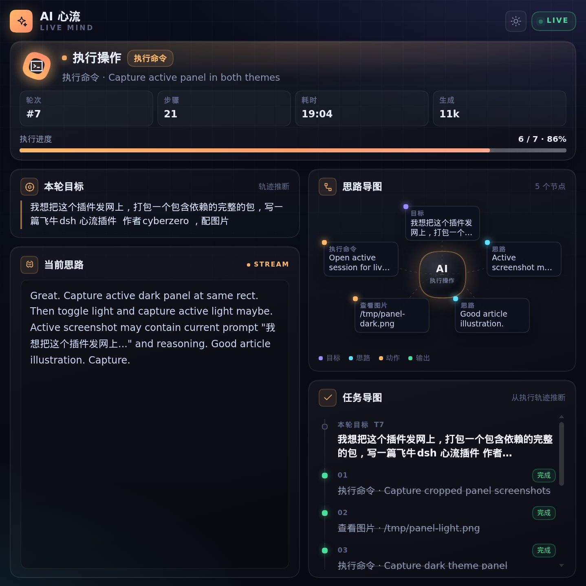
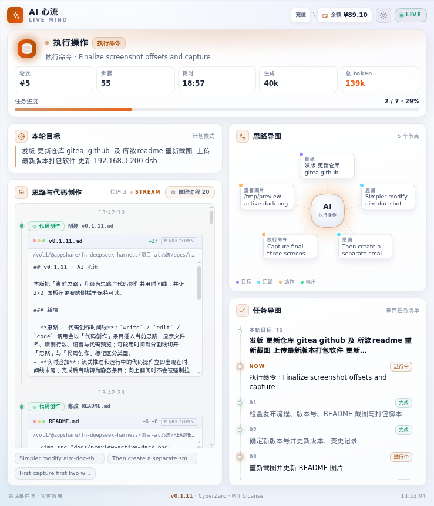
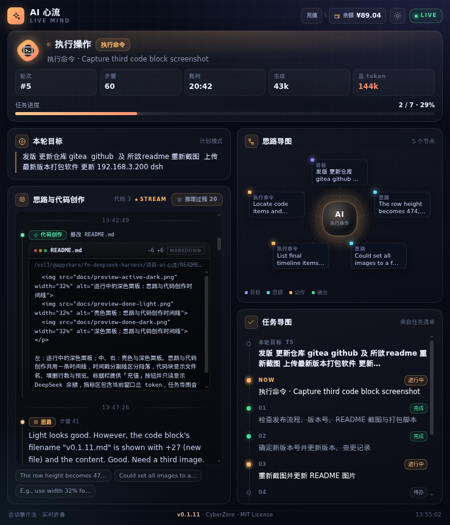

# dsh-ai-mind · AI 心流

作者：**CyberZero** · MIT License · 当前版本：`v0.1.10`

DSH 右侧栏插件：把当前会话里 AI 的**实时状态、思路、任务进度、思路导图、任务导图**折叠到一页。

## 预览

<p align="center">
  
  
  
</p>

左：执行中的深色面板；中、右：本轮完成后的亮色与深色面板。标题栏提供「充值」按钮并只读显示 DeepSeek 余额，指标区包含当前窗口总 token，任务导图会把正在执行的工具置顶为 `NOW`。

## 显示什么

- **实时阶段**：待命 / 等待响应 / 推理中 / 组织回答 / 执行操作 / 本轮完成 / 需要处理。
- **当前动作**：正在调用的工具、目标文件或命令、轮次、步骤、耗时、生成 token，以及当前窗口输入/缓存/输出的总 token（悬停可看拆分）。
- **本轮目标**：最后一条真实用户消息。
- **当前思路**：模型可见的 reasoning 流；流式输出时实时追加并显示光标。标题栏的「推理过程 N」可回放本轮最近 20 段推理；向上翻阅时不会被新输出强制拉回底部。
- **思路导图**：目标 → 思路 → 最近动作 → 输出，以放射状节点图呈现，当前动作高亮。
- **任务导图**：优先读取 `todo/write` 的任务清单与完成度；清单超过 40 步未刷新时自动退回真实工具轨迹，并把进度标为「执行进度」，避免展示过期计划。当前正在执行的工具会以 `NOW · 进行中` 置顶显示，不依赖它是否出现在待办清单里。
- **实时进度条**：完成数 / 总数，执行中带流光动画。
- **充值入口与余额**：标题栏「充值」按钮直达 DeepSeek 充值中心，旁边只读显示账户余额；余额不足时余额变警示色。
- **亮色 / 暗色主题**：默认跟随 DSH 当前外观，也可在标题栏一键切换。

数据来自 `ctx.sessions` 的会话事件窗（durable event + `assistant/live-chunk`），不调用模型、不在服务端落任何数据。余额是唯一例外：插件服务端用本机 `DEEPSEEK_API_KEY` 查询官方余额接口，缓存 60 秒；页面每分钟自动刷新，切回页面时立即刷新。仅把币种和金额返回浏览器，密钥不下发。

## 更新日志

### 0.1.10

- **一键安装**：新增根目录 `install.sh`，一条命令完成下载、SHA256 校验、解压和安装；默认走 Gitea，`AIM_MIRROR=github` 可切换 GitHub。
- **安装脚本**：完整发布包内的 `install.sh` 会检测 `dsh-better-sidebar`，已安装时跳过，避免把较新版本降级到 0.26.0。
- **README**：重写下载与安装章节，以当前版本的一键安装为默认方式，保留手动安装、纯插件包和源码安装。
- **发布同步**：Gitea 补齐 0.1.6–0.1.10 的 Release 与安装包，两个平台的下载链接保持一致。
- **无插件行为变更**：`lib/client.js` 与 0.1.9 一致，已装 0.1.9 的用户可按需升级。

### 0.1.9

- **文档**：新增「左侧会话列表标题换行、时间掉到第二行」的排查说明，给出 DSH 模块加载器认领未打标 `<style>` 的定位方法与修复方式。
- **文档**：下载链接、安装命令、打包说明更新到 0.1.9。

### 0.1.8

- **充值按钮配色**：与余额胶囊统一为同底色、同描边、同字号，悬停反馈保持一致；亮色主题同步，「充值 \ 余额」视觉上成为一组。

### 0.1.7

- **充值按钮**：标题栏余额区拆成「充值 \ 余额」；`充值` 改为强调色按钮，点击直达 DeepSeek 充值中心。
- **余额只读**：`余额 ¥x` 只展示金额，不再整块可点；悬停仍显示查询时间与充值入口提示。

### 0.1.6

- **作者与授权**：右侧栏面板底部中间常驻小字 `CyberZero · MIT License`；窄面板或矮窗口只隐藏两侧辅助信息，署名保持可见。
- **版权声明**：README 新增「版权与许可」章节，作者、`LICENSE` 与 `package.json` 统一为 CyberZero，并注明再分发时保留声明。

### 0.1.5

- **DeepSeek 余额**：标题栏常驻显示充值中心余额，点击直达充值页；服务端用 `DEEPSEEK_API_KEY` 查询并缓存 60 秒，密钥不下发浏览器。
- **余额自动刷新**：页面每分钟更新一次，切回页面立即刷新；请求失败自动重试。
- **推理过程回放**：当前思路卡片可展开本轮最近 20 段推理，流式输出时实时追加；向上翻阅时不会被强制拉回底部。
- **任务导图 NOW**：正在执行的工具置顶为 `NOW · 进行中`，即使它还没写进 todo 清单也会显示。
- **总 token**：执行进度卡片新增当前窗口输入 / 缓存 / 输出合计，悬停查看拆分。
- **网关兼容**：余额请求改用相对路径，兼容 fnOS `/app/...` 反向代理前缀。
- **文档与预览**：重写安装说明，更新运行中 / 完成态、亮色 / 深色三张预览图。

### 0.1.4

- 一屏式 bento 面板：实时阶段、当前动作、本轮目标、当前思路、思路导图、任务导图。
- 亮色主题、按面板宽度切换的单列布局、会话跟随与自动收起。

## 布局

右侧栏是一块固定的一屏 dashboard，页面本身不滚动：

- 顶部状态 hero：阶段、当前动作、五项指标、执行进度；
- 2×2 bento：左侧「本轮目标 + 当前思路」，右侧「思路导图 + 任务导图」；
- 卡片内部各自滚动，长思路、多任务不会把整页撑开；
- 用容器查询按**面板宽度**（不是浏览器视口）切换：小于 640px 时自动改为单列堆叠，仍然一屏展示全部区块。

## 主题

- 默认跟随 DSH 外观：DSH 是浅色时面板自动用亮色主题，DSH 切到深色时自动变暗；
- 标题栏右侧的太阳 / 月亮按钮可手动切换，选择写入 `localStorage`（`dsh-ai-mind:theme`），之后以手动选择为准；
- 亮色主题使用与深色版相同的布局和强调色体系，重新调过对比度，不会出现“白底灰字”。

## 跟随当前会话

- 打开有内容的会话时，标签自动出现在右侧，并随会话切换重新订阅 `scope.sessionId`，内容跟着对话走；
- 空白会话（首页 / New task）不自动打开，避免为了一个没有内容的 panel 挤占整个 DSH 布局；
- 如果从会话切回 New task，残留在空白会话里的「AI 心流」会自动收起，左侧栏目和顶部恢复原宽度；
- 手动关闭后，该会话不会再次自动打开；切到别的会话仍会正常出现。

## 下载

当前版本：`v0.1.10`

| 文件 | 用途 | 大小 | GitHub | Gitea |
| --- | --- | --- | --- | --- |
| 完整发布包 | 插件 + `dsh-better-sidebar` + 安装脚本 + README/预览图 | 约 7.4 MB | [下载](https://github.com/magicindex/dsh-ai-mind/releases/download/v0.1.10/dsh-ai-mind-0.1.10-fnos-release.zip) | [下载](https://gitea.topzero.cn:10241/cyberzero/dsh-ai-mind/releases/download/v0.1.10/dsh-ai-mind-0.1.10-fnos-release.zip) |
| 纯插件包 | 已装好 `dsh-better-sidebar` 时使用 | 约 32 KB | [下载](https://github.com/magicindex/dsh-ai-mind/releases/download/v0.1.10/dsh-ai-mind-0.1.10.tgz) | [下载](https://gitea.topzero.cn:10241/cyberzero/dsh-ai-mind/releases/download/v0.1.10/dsh-ai-mind-0.1.10.tgz) |

发布页：

- GitHub：https://github.com/magicindex/dsh-ai-mind/releases/tag/v0.1.10
- Gitea：https://gitea.topzero.cn:10241/cyberzero/dsh-ai-mind/releases/tag/v0.1.10

校验值随发布提供，见发布页的 `SHA256SUMS` 附件。

> GitHub 适合公网分享；Gitea 为自建实例，国内访问更稳定。GitHub 下载受阻时优先使用 Gitea。

## 安装

### 前置条件

- DSH `0.2.0-rc.2` 左右版本。
- 已安装并启用 `dsh-better-sidebar >= 0.26.0`。插件通过它的公开 `registerTab` API 注册右侧页签；一键安装会自动补齐，已安装则跳过，不会降级。
- 使用**运行 DSH 的同一系统用户**执行安装命令，避免插件文件归属错误。
- 首次安装 `dsh-better-sidebar` 的传递依赖需要联网。
- 余额显示需要 DSH 进程环境里存在 `DEEPSEEK_API_KEY`；未配置时余额显示 `—`，其他功能不受影响。

### 方式一：一键安装（推荐）

在运行 DSH 的机器上执行，默认安装到 `web` profile：

```bash
curl -fsSL https://gitea.topzero.cn:10241/cyberzero/dsh-ai-mind/raw/branch/main/install.sh | bash -s -- web
```

GitHub 源（内容相同，二选一）：

```bash
curl -fsSL https://raw.githubusercontent.com/magicindex/dsh-ai-mind/main/install.sh | bash -s -- web
```

脚本会依次完成：

1. 下载 `v0.1.10` 完整发布包；
2. 下载 `SHA256SUMS` 并校验安装包；
3. 解压到临时目录；
4. 安装 `dsh-better-sidebar`（已安装则跳过）；
5. 安装 `dsh-ai-mind`，随后清理临时文件。

profile 不叫 `web` 时，把最后的 `web` 换成实际名称：

```bash
curl -fsSL https://gitea.topzero.cn:10241/cyberzero/dsh-ai-mind/raw/branch/main/install.sh | bash -s -- <profile>
```

需要换源或指定版本时：

```bash
# 改走 GitHub 源
curl -fsSL https://gitea.topzero.cn:10241/cyberzero/dsh-ai-mind/raw/branch/main/install.sh | AIM_MIRROR=github bash -s -- web

# 指定版本（默认为 0.1.10）
curl -fsSL https://gitea.topzero.cn:10241/cyberzero/dsh-ai-mind/raw/branch/main/install.sh | AIM_VERSION=0.1.10 bash -s -- web
```

安装完成后重启 DSH，见[重启并确认](#重启并确认)。

### 方式二：完整发布包手动安装

下载并解压：

```bash
curl -fL -o dsh-ai-mind-0.1.10-fnos-release.zip \
  https://gitea.topzero.cn:10241/cyberzero/dsh-ai-mind/releases/download/v0.1.10/dsh-ai-mind-0.1.10-fnos-release.zip

unzip dsh-ai-mind-0.1.10-fnos-release.zip
cd dsh-ai-mind-0.1.10
chmod +x install.sh
./install.sh web
```

GitHub 源把第一行 URL 换成：

```text
https://github.com/magicindex/dsh-ai-mind/releases/download/v0.1.10/dsh-ai-mind-0.1.10-fnos-release.zip
```

`install.sh` 会依次安装 `vendor/dsh-better-sidebar-0.26.0.tgz`（已安装则跳过）和 `dsh-ai-mind-0.1.10.tgz`。profile 不叫 `web` 时把 `web` 换成实际名称：

```bash
./install.sh <profile>
```

### 方式三：只装插件包

已经启用 `dsh-better-sidebar` 时：

```bash
curl -fL -o dsh-ai-mind-0.1.10.tgz \
  https://gitea.topzero.cn:10241/cyberzero/dsh-ai-mind/releases/download/v0.1.10/dsh-ai-mind-0.1.10.tgz

dsh plugin --profile web add ./dsh-ai-mind-0.1.10.tgz
```

还没装 `dsh-better-sidebar`：

```bash
dsh plugin --profile web add dsh-better-sidebar@0.26.0
dsh plugin --profile web add ./dsh-ai-mind-0.1.10.tgz
```

也可以从完整发布包的 `vendor/` 目录安装离线包：

```bash
dsh plugin --profile web add ./dsh-ai-mind-0.1.10/vendor/dsh-better-sidebar-0.26.0.tgz
dsh plugin --profile web add ./dsh-ai-mind-0.1.10/dsh-ai-mind-0.1.10.tgz
```

### 方式四：从源码安装（开发）

```bash
git clone https://github.com/magicindex/dsh-ai-mind.git
cd dsh-ai-mind
npm run build
dsh plugin --profile web add .
```

### 重启并确认

安装完成后重启 DSH：

```bash
dsh web
```

重启后打开一个**已有内容的会话**，右侧栏会自动出现「AI 心流」页签。若之前手动关闭过，可从右侧栏的 `+` 菜单重新打开。

空白会话（首页 / New task）不会自动打开面板，这是刻意设计，避免无内容的 panel 挤占布局。

### 常见问题

**`dsh plugin add` 被 `minimumReleaseAge` 拦住**

本机安装时出现过 `billion-context` 触发该策略。可临时放行，或手动把插件写入 profile 的 `dependencies` 和 `dsh.profile.bundles`，再执行：

```bash
dsh --profile web --dump-config
```

重新生成 `cordis.yml` 后重启。

**重启后没有「AI 心流」**

- 确认 `dsh-better-sidebar` 已安装并在 profile 中启用；
- 确认当前是已有内容的会话，而不是空白首页；
- 完全重启 `dsh web`，仅刷新浏览器不会重新加载宿主插件。

**面板显示但内容不更新**

面板订阅的是当前会话的 `ctx.sessions` 事件窗；切换会话后会重新订阅。若仍不更新，先确认 DSH 版本与插件版本匹配。

**左侧会话列表标题换行、时间与按钮掉到第二行**

这是 DSH 客户端模块加载器的问题，与本插件的样式无关。加载器重载某个插件时，会把文档里所有**未打标**（没有 `data-plugin`）的 `<style>` 认领到该插件名下；而 codex-ui 侧栏的样式是 React 渲染、从不打标的。于是开发期插件（例如本插件被 `link:` 引入并频繁重建时）一重建，`removeOwnedStyles` 就会把侧栏样式一起删掉，所有 `.dcu-*` 规则失效，长标题自然把时间和操作按钮挤到下一行。

定位方法：控制台里 `document.querySelectorAll('style:not([data-plugin])').length`，正常应大于 0；若为 0 且 `.dcu-wb-session` 被算成 `display:block; padding:0`，即命中该问题。

修复方式（`@deepseek-ai/dsh-client-modules` 的 `claimStyles`）：在 `materialize()` 调用工厂前先记下已存在的未打标 `<style>`，之后只认领本次新建的，不再碰其他插件渲染的样式：

```js
const untaggedBefore = new Set(document.querySelectorAll('style:not([data-plugin])'));
// …执行插件工厂…
styles: claimStyles(ownerId, untaggedBefore)
```

改完重启 DSH 并刷新页面。临时恢复也可以只刷新浏览器，但下一次插件重建仍会复发。

## 版权与许可

本项目由 **CyberZero** 开发，以 **MIT License** 开源授权发布。

- Copyright (c) 2026 CyberZero
- 完整许可文本见 [LICENSE](LICENSE)
- 插件面板底部中间常驻小字「CyberZero · MIT License」，用于保留作者署名与开源授权声明
- 复制、修改、分发或再发布时，请保留本声明以及 [LICENSE](LICENSE) 中的版权与许可声明

## 打包分发

```bash
npm pack                 # 生成 dsh-ai-mind-0.1.10.tgz，prepack 会自动重建 lib/client.js
```

发布包（zip）还包含 `dsh-better-sidebar` 安装包、`install.sh`、文章和截图。包内只含 `lib/`、`cordis.patch.yml`、`README.md`、`LICENSE` 和 `package.json`；`src/`、测试不进入 npm 分发包。

## 开发

```bash
npm run build    # src/model.cjs + src/styles.css + src/client.js → lib/client.js
npm test         # 纯模型测试（node:test）
```

- `src/model.cjs`：纯函数折叠会话事件，无 React / 浏览器依赖。
- `src/client.js`：右侧栏 React 页，直接使用平台提供的 `react`。
- `src/styles.css`：全部样式以 `.aim-root` 作用域隔离，深色玻璃拟态 + 微动效。
- `lib/client.js`：构建产物，DSH 通过 `/plugins/dsh-ai-mind/client.js` 提供。

## 兼容性

- DSH `0.2.0-rc.2`
- `dsh-better-sidebar >= 0.26.0`（使用其公开的 `registerTab` API）
- 浏览器需支持 `color-mix()`；不支持时仅降低部分半透明层次，不影响功能。
